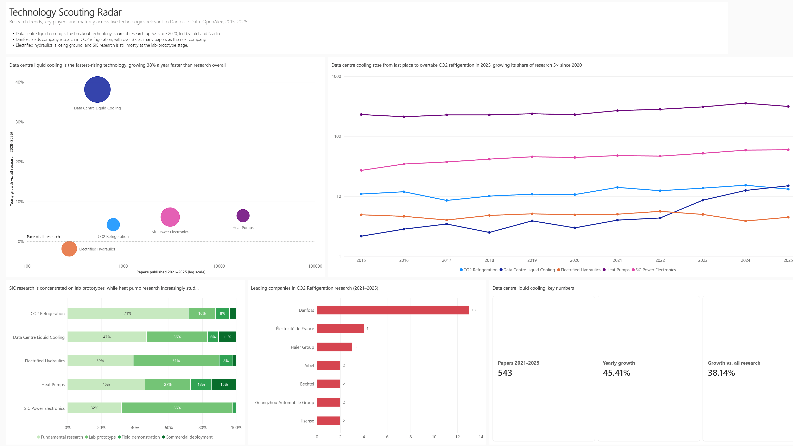
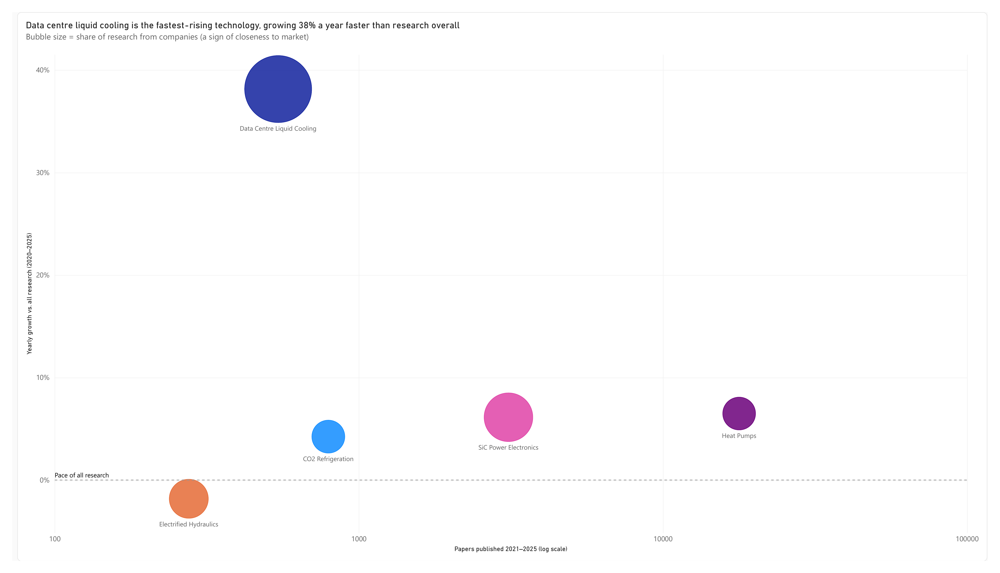
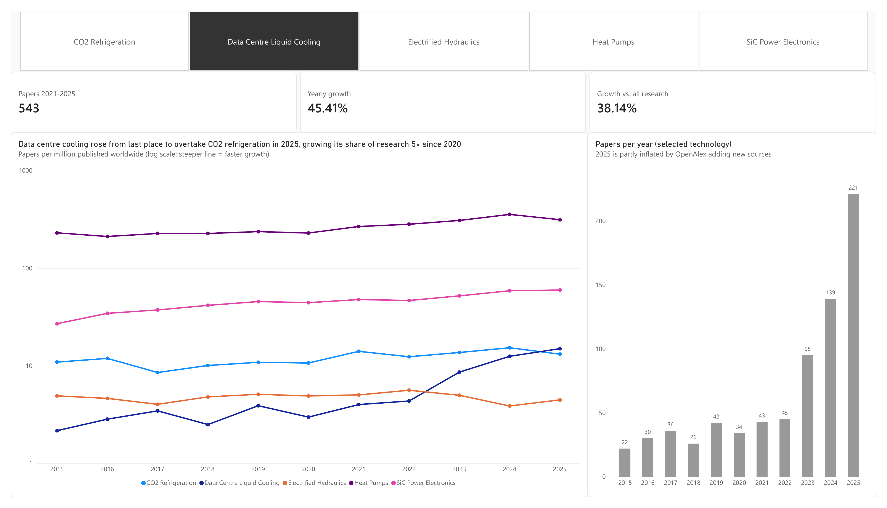
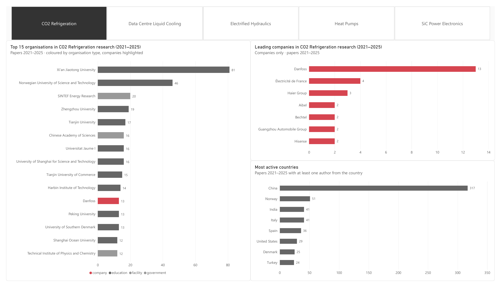
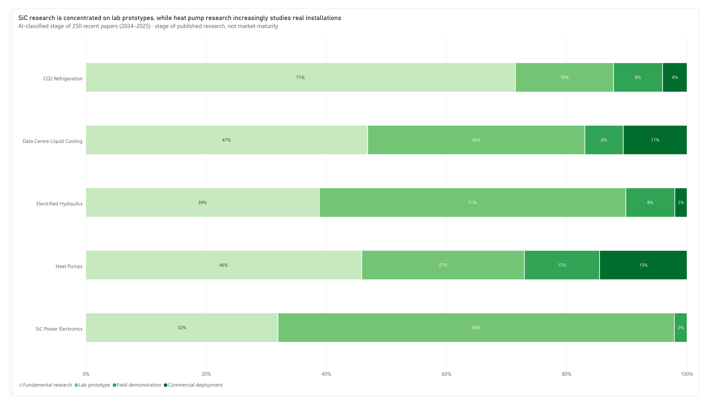
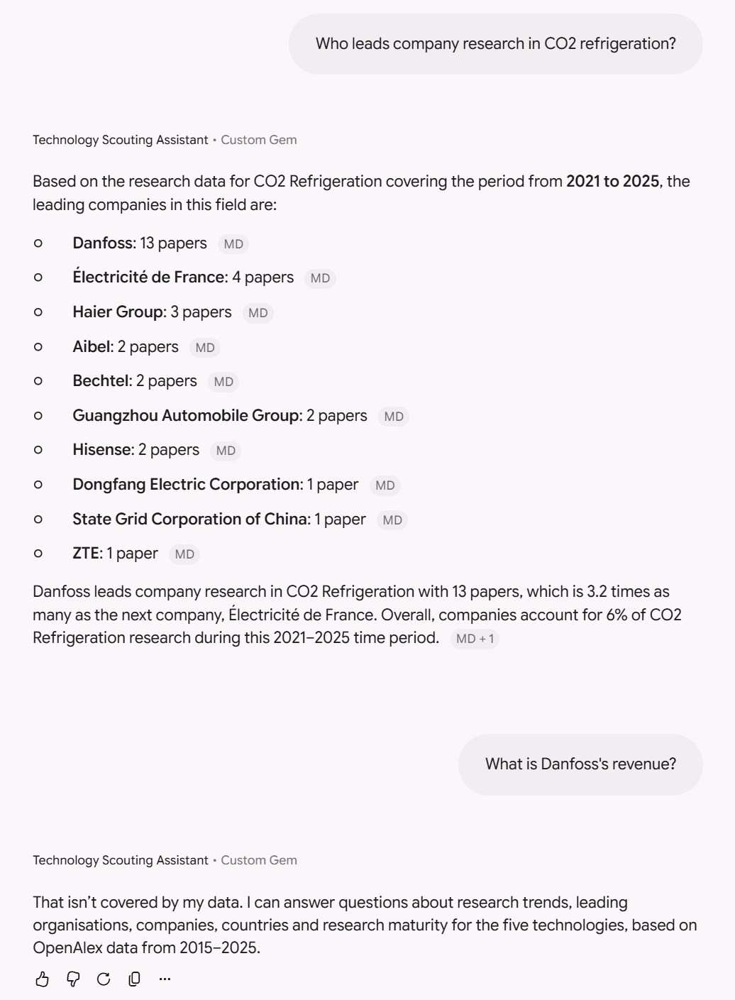

# Technology Scouting Radar

**Research trends, key players and maturity across five technologies relevant to Danfoss**: CO2 refrigeration, heat pumps, SiC power electronics, data centre liquid cooling and electrified hydraulics. Built with Python, OpenAlex, Google Gemini and Power BI.



## Key findings

- **Data centre liquid cooling is the breakout technology.** Its share of research grew 5× since 2020 (38% a year faster than research overall), led by Intel and Nvidia.
- **Danfoss leads company research in CO2 refrigeration**, with over 3× as many papers as the next company, and is the only company in the field's top 15 organisations.
- **Electrified hydraulics is losing ground**, growing slower than research overall.
- **SiC research is mostly at the lab-prototype stage** (66% of recent papers), while heat pumps have the most research on real installations.

## The report

| Radar | Trends |
|---|---|
|  |  |
| **Players** | **Maturity** |
|  |  |

Full report: [`danfoss-tech-radar.pbix`](dashboard/danfoss-tech-radar.pbix) (Power BI) · [`PDF`](dashboard/technology-scouting-radar.pdf)

## Method

1. **Data collection.** Each technology is defined by a tested keyword query on paper titles and abstracts in [OpenAlex](https://openalex.org). Python scripts collect yearly paper counts (2015–2025), leading organisations, companies and countries (2021–2025).
2. **Fair growth measure.** Growth is measured as each technology's share of all research, which corrects for overall growth in publishing and for OpenAlex expanding its index in 2025.
3. **AI maturity classification.** Google Gemini classifies 250 recent abstracts into four stages based on Technology Readiness Levels (fundamental research, lab prototype, field demonstration, commercial deployment), and filters out off-topic papers. It uses structured output, gives a short justification per paper, and resumes automatically if interrupted.
4. **Power BI.** A star-schema model with DAX measures such as relative growth (CAGR), company share and maturity share, a four-page report and a one-page dashboard.

## AI assistant (prototype)

A Gemini Gem answers questions about the data using an auto-generated knowledge brief ([`knowledge/technology_brief.md`](knowledge/technology_brief.md)) as its only source. It cites the brief for every answer and declines questions outside its data. The same brief could be used in Microsoft Copilot Studio.

**[Try the assistant](https://gemini.google.com/gem/1fdn1qLSqO-kekPt5WxqknLMm2Xsi4Svy?usp=sharing)** · Example: *"Who leads company research in CO2 refrigeration?"*



## Limitations

The maturity view shows where **published research** is focused, not market maturity, since companies rarely publish on finished products. Paper counts also miss patented and confidential work, and rankings in small fields rest on few papers.

## Run it yourself

```bash
git clone https://github.com/DovydasGan/danfoss-tech-radar.git
cd danfoss-tech-radar
pip install -r requirements.txt
```

Copy `.env.example` to `.env`, add free [OpenAlex](https://openalex.org/settings/api) and [Gemini](https://aistudio.google.com) API keys, then run the scripts in `scripts/` in order: `collect_trends`, `collect_players`, `collect_abstracts`, `classify_maturity`, `build_knowledge_brief`. Refresh the Power BI file to load new data.

## Next steps

Add patent data (EPO OPS API) to compare research with commercial activity, publish the assistant in Microsoft Teams via Copilot Studio, and schedule automatic data refresh.

---

Built by **Dovydas Gansauskas** · Data: OpenAlex, retrieved October 2026
